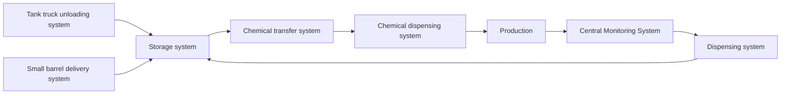

# Chemical Dosing System

## Material

1. PVC
2. PFA
3. PPH
4. Stainless steel

## Centralize Chemcial Supply System

**Chemical Dispensing Control (CDC)**

**Constant-Pressure Pumping Chemical Supply system**

**Gravity Feed Chemical Supply System**

### Chemical Transfer System

1. Transfer pump
2. Valve
3. Containment pipelines
4. Control components

Basic Operating Requirement:-
1. Flow rate
2. Pump head
3. Pressure gauge

**Key Considerations**
1. Corrosion resistance
2. Oxidation resistance
3. Wear resistance
4. Dry-run protection
5. Low noise
6. Low vibration